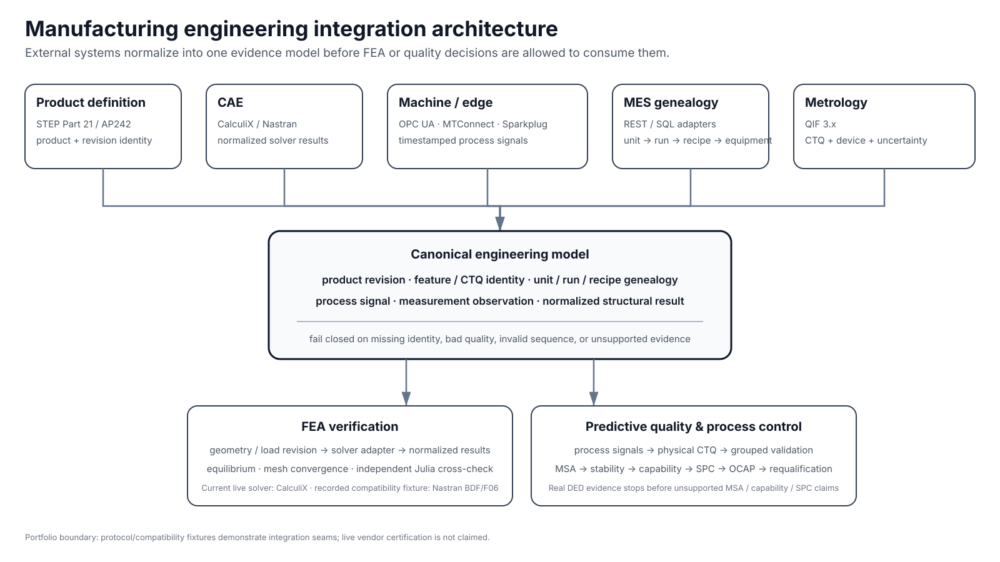
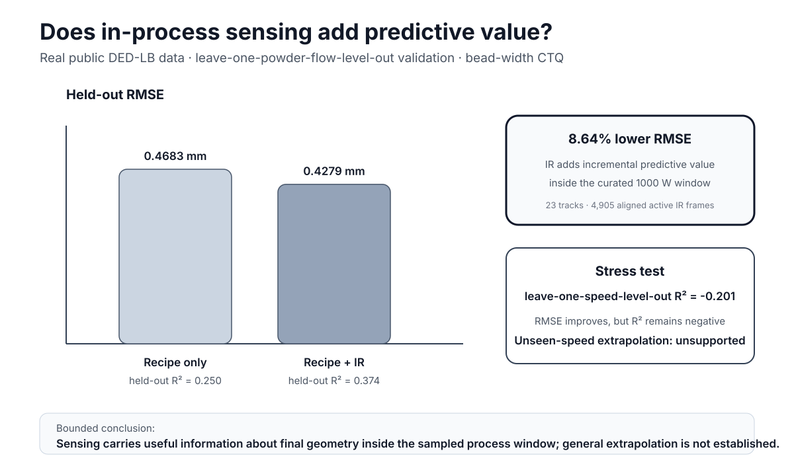
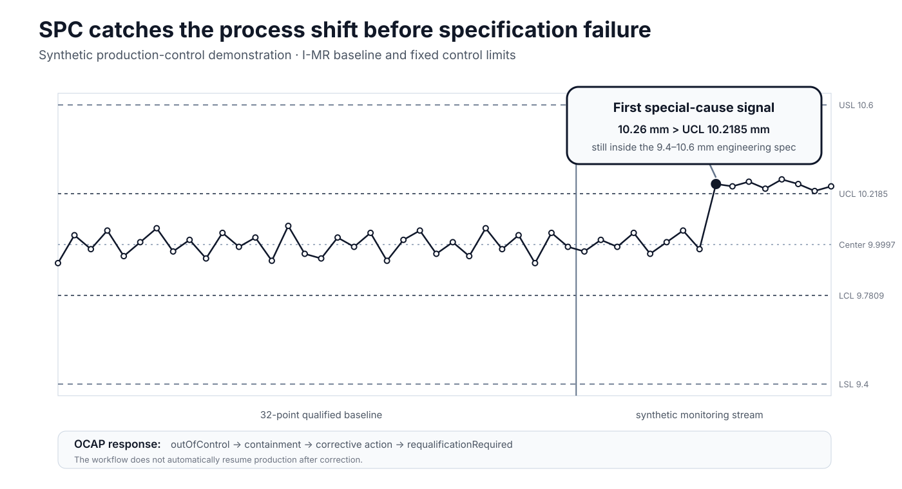

# Portfolio Brief — Predictive Quality & Process Control

## 60-second review

This project demonstrates how an engineer can connect an existing manufacturing stack to a traceable quality-control workflow rather than requiring a greenfield system.

**Real manufacturing result:** on 23 evidence-clean DED-LB tracks containing 4,905 laser-active IR frames, adding in-process IR features reduced grouped-held-out bead-width RMSE from **0.4683 mm to 0.4279 mm (8.64%)** and increased held-out R² from **0.250 to 0.374**. A harder unseen-speed holdout remained below zero R², so extrapolation is explicitly not claimed.

**Production-control workflow:** the real dataset is automatically blocked from MSA, capability, and SPC because it lacks the required production evidence. A separate synthetic stream demonstrates crossed Gage R&R, process stability, Cp/Cpk/Pp/Ppk, I-MR monitoring, OCAP containment, corrective action, and mandatory requalification.

**Integration layer:** the same canonical model accepts product/revision identity from STEP AP242, metrology from QIF, process signals from OPC UA / MTConnect / Sparkplug B, genealogy from MES REST/SQL adapters, and structural results from CalculiX or a recorded Nastran BDF/F06 compatibility lane.



## What is real, synthetic, and compatibility-only?

| Layer | Evidence authority | What can be claimed |
| --- | --- | --- |
| DED process → final bead width | **real public data** | IR adds predictive information inside the sampled 1000 W window |
| NIST AMB2022 metrology | **real public physical measurements** | uncertainty-aware dimensional evidence |
| CalculiX structural study | **executed numerical analysis** | bounded verification of the declared numerical model |
| Julia cross-check | **independent executed verification** | independent mechanics reconstruction and raw solver-output parsing |
| MSA / capability / SPC / OCAP demo | **synthetic** | reusable workflow behavior only; not DED process capability |
| AP242 / QIF / OPC UA / MTConnect / Sparkplug / MES fixtures | **recorded/open compatibility fixtures** | protocol-boundary parsing and state/identity handling; not vendor certification |
| Nastran BDF/F06 | **recorded compatibility fixture** | shared solver-result contract; not live Nastran execution |

## Why this is useful to a manufacturing team

The implementation separates **engineering identity** from vendor transports and calculations.

A product revision, CTQ, unit, run, recipe, measurement system, machine signal, and solver result keep explicit identities as they move through the workflow. Missing identity, bad protocol quality, broken sequence state, or missing statistical prerequisites fail closed.

That architecture supports a company that already has a mix of CAD/PLM, CAE, MES, CMM/metrology, PLC/historian, QMS, and statistical tools.

## Evidence at a glance





## Engineering behaviors demonstrated

- validates unit/run/CTQ lineage before modeling;
- rejects a strong-looking result when source identity is wrong;
- compares recipe-only and sensing-enhanced models on grouped holdouts;
- distinguishes interpolation evidence from unseen-regime extrapolation;
- qualifies the measurement system before capability;
- separates statistical control limits from engineering specifications;
- triggers containment on special-cause evidence before spec failure;
- requires requalification after corrective action;
- normalizes external manufacturing protocols into vendor-neutral contracts;
- keeps unsupported quantities and unavailable evidence explicit rather than fabricating values;
- binds generated results to source inputs through deterministic receipts.

## Reproduce

```bash
npm run study:fixture:verify
```

The full verification regenerates DED prediction, quality-control workflow, integration-adapter assessment, TypeScript tests, Julia cross-check, canonical research state, and project checks.
